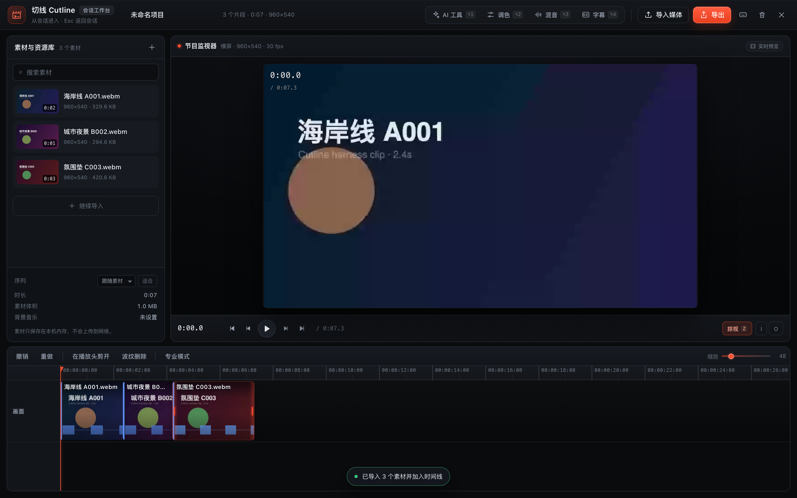

# lizz-DSH

DeepSeek Harness（DSH）插件与本地媒体资源工作区。

## 目录

| 目录 | 内容 |
|---|---|
| [`zhizhen-cut/`](zhizhen-cut/) | **zhizhen-cut**（切线 Cutline）：从会话进入的单窗口视频剪辑工作台插件（多视频导入、磁吸时间线、音频角色/自动闪避、AI 粗剪/脚本字幕/9 种调色、MP4 导出） |
| [`music-library/`](music-library/) | 10 首本地背景音乐，按类型分目录，含 CC BY 4.0 署名说明与 `catalog.json` 元数据 |



## zhizhen-cut · 切线 Cutline

- **入口**：会话输入框左侧「剪辑」按钮，或 `⌥C`；`Esc` 返回会话。
- **剪辑**：磁吸时间线、拖拽重排、边缘修剪、播放头剪开（B / ⌘B）、波纹删除、掠视预览、触控板捏合缩放、专业模式角色泳道。
- **声音**：对白 / 音乐 / 环境声角色混音、背景音乐垫、自动闪避。
- **AI**：本地音频静音检测智能粗剪、脚本字幕自动排轨、9 种智能调色；缺少音频峰值时会自动从视频提取。
- **导出**：默认 **MP4（H.264 + AAC）**，支持 1080p/720p/4K、24/30/60fps、字幕与背景音乐；仅在浏览器不支持 MP4 录制时回退 WebM 并提示。
- **画幅**：竖屏手机素材自动建立 9:16 序列并按竖屏画幅预览；可切换序列格式与适合/填充。

### 开发

```bash
cd zhizhen-cut
node scripts/build.mjs          # 从 src/ 生成 client.js
node scripts/smoke.mjs          # 模块注册 smoke
node scripts/render-smoke.mjs   # 工作台渲染 smoke
node scripts/timeline-smoke.mjs # 时间线渲染 smoke
node --test tests/engine.test.mjs
```

安装/更新插件后刷新 DSH 页面（⌘R）以载入最新 `client.js`。

详细说明见 [`zhizhen-cut/README.md`](zhizhen-cut/README.md)。

## 背景音乐库

来自 [Incompetech](https://incompetech.com/music/royalty-free/music.html)（Kevin MacLeod），许可为 [CC BY 4.0](https://creativecommons.org/licenses/by/4.0/)：可商用，发布时需署名。署名模板、曲目清单和校验和见 [`music-library/README.md`](music-library/README.md) 与 [`music-library/catalog.json`](music-library/catalog.json)。

## 许可

- 代码：MIT，见 [`LICENSE`](LICENSE)。
- 背景音乐：CC BY 4.0，详见 [`music-library/README.md`](music-library/README.md)。
